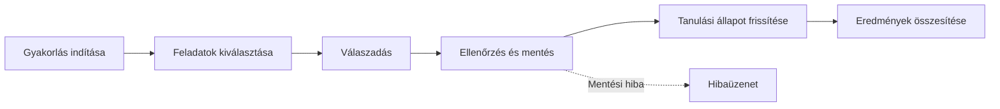
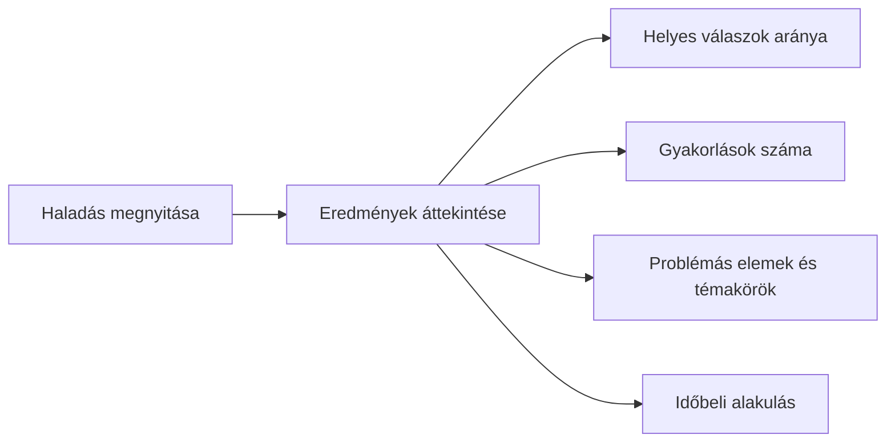

# Nyelvtanulási segéd egyéni haladáskövetéssel

Szerző:  Makai Tímea

Neptun:  KFICIY

Témavezető:  Lénárt Anett

Projektazonosító: 2026-LA-05

---

## Probléma

-   Eltérő tanulási ütem
-   Egyéni nehézségek figyelmen kívül hagyása  
-   Válaszok és előzmények megőrzése
-   **Fő kérdés:** következőként gyakorlandó elemek kiválasztása

---

## Célfelhasználók

**Tanuló**

-   Angol szavak és kifejezések gyakorlása
-   Válaszadás, azonnali visszajelzés
-   Eredmények és problémás elemek áttekintése

---

## Korlátok

-   **Nyelv:** angol
-   **Adatbázis:** Oracle Database, PL/SQL
-   **Adatmodell:** legalább 10 tábla, 3. normálforma
-   **Üzleti logika:** adatbázis-alapú gyakorlási sorrend

---

## Tervezett hatókör

**Benne van**

-   Tananyag: szavak, kifejezések, jelentések, példamondatok
-   Témakörök, nehézségi szintek
-   Felhasználók, gyakorlások, feladatok, válaszok, tanulási állapotok
-   2 kiválasztási stratégia összehasonlítása
    

**Nincs benne**

-   Közösségi funkciók
-   Hanganyagok, kiejtésértékelés
-   Többnyelvű támogatás

---

## Tervezett technikai megoldás

-   **Webes felület:** gyakorlás, haladáskövetés
-   **Szerveroldal:** kérések továbbítása, ellenőrzés
-   **Oracle Database:** tananyag, válaszok, előzmények
-   **PL/SQL:** prioritásszámítás, feladatkiválasztás
-   **Prioritási szempontok:**
    -   Helyes / hibás válaszok
    -   Utolsó gyakorlás időpontja
    -   Ismétlésszám
    -   Nehézségi szint

---

## Prioritásszámítás – egyszerű stratégia

-   **Alappontszám:** 1 pont / tananyagelem
-   **Rendezés:** utolsó gyakorlás időpontja
-   **Előnyben:** régebben gyakorolt, még nem gyakorolt elemek
-   **Döntetlen esetén:** másodlagos rendezési szabály
-   **Cél:** egyszerű, átlátható referencia-módszer

---

## Prioritásszámítás – súlyozott stratégia

A prioritási pontszám a tanuló korábbi teljesítménye alapján változik.

| Szempont | Pont |
|:---|:---|
| Legutóbbi válasz hibás | +3 |
| Korábbi hibaarány legalább 40% | +2 |
| Legalább 7 nap telt el az utolsó gyakorlás óta | +2 |
| Közepes nehézség | +1 |
| Nehéz tananyagelem | +2 |
| Legutóbbi válasz helyes | −1 |

-   **Minimum:** 0 pont
-   **Nagyobb pontszám:** magasabb prioritás
-   **Azonos pontszám:** régebben gyakorolt elem előre
-   **Cél:** több ismétlést igénylő elemek előtérbe helyezése

---

## Kezdeti felhasználói utak

**1. Személyre szabott gyakorlás**

**2. Haladás megtekintése**

**Hibakezelés:** érvénytelen válasz, sikertelen mentés, hiányzó előzmények.

---

## Következő lépések
-   Visszajelzések beépítése a specifikációba
-   A technikai részletek kidolgozása