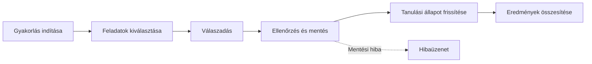
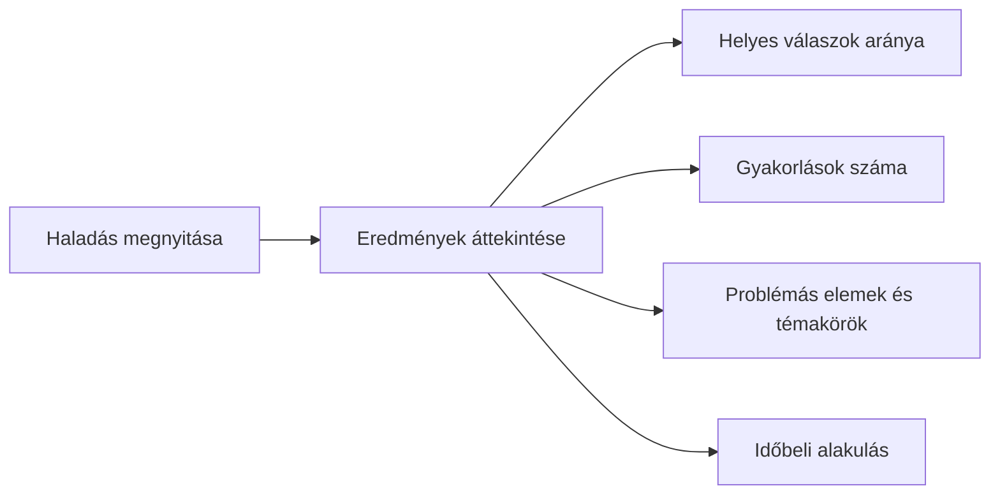

# Nyelvtanulási segéd egyéni haladáskövetéssel

Szerző:  Makai Tímea
Neptun:  KFICIY
Témavezető:  Lénárt Anett
Projektazonosító: 2026-LA-05

----------

## Probléma

-   A tanulók nem minden szót és kifejezést sajátítanak el ugyanolyan gyorsan.
-   Az egységes gyakorlási sorrend nem veszi kellően figyelembe az egyéni nehézségeket.
-   A személyre szabáshoz meg kell őrizni a válaszokat és a gyakorlási előzményeket.
-   **Fő kérdés:** mely tananyagelemeket érdemes a következő alkalommal előrevenni?

----------

## Célfelhasználók

**Tanuló**

-   Angol szavak és kifejezések gyakorlása.
-   Válaszadás és azonnali visszajelzés.
-   Saját eredmények és problémás tananyagelemek áttekintése.

----------

## Korlátok

-   **Egy nyelv:** az első változat az angol tanulását támogatja.
-   **Adatbázis:** relációs modell, tervezetten Oracle Database és PL/SQL.
-   **Adatmodell:** legalább 10 kapcsolódó tábla, legalább 3. normálforma.
-   **Üzleti logika:** a gyakorlási sorrendet az adatbázis állítja elő.

----------

## Tervezett hatókör

**Benne van**

-   Tananyag: szavak/kifejezések, jelentések, példamondatok, témakörök, nehézségi szintek.
-   Felhasználók, gyakorlási alkalmak, feladatok, válaszok és tanulási állapotok kezelése.
-   Két kiválasztási stratégia és összehasonlításuk.
-   Legalább 10 összetett SQL-lekérdezés és legalább 5 lekérdezés teljesítményvizsgálata.
-   Reprodukálható tesztadat több tízezer válasszal és gyakorlási eseménnyel.

**Nincs benne**

-   Közösségi funkciók.
-   Hanganyagok és kiejtésértékelés.
-   Több nyelv egyidejű támogatása.

----------

## Tervezett technikai megoldás

-   **Webes felület:** gyakorlás és haladás megjelenítése.
-   **Szerveroldali réteg:** a felhasználói kérések továbbítása és ellenőrzése.
-   **Oracle Database:** tananyag, válaszok és előzmények tárolása.
-   **PL/SQL-logika:** prioritásszámítás és a következő gyakorlási sor összeállítása.
-   A prioritás figyelembe veszi a helyes/hibás válaszokat, az utolsó gyakorlás idejét, az ismétlésszámot és a nehézséget.

----------

## Prioritásszámítás – egyszerű stratégia

-   Minden tananyagelem azonos, **1 pontos alapértéket** kap.
    
-   Kiválasztás: legutóbbi gyakorlás időpontja alapján
    
-   Előny: régebben gyakorolt és a még nem gyakorolt elemek
    
-   Azonos időpont esetén egy másodlagos rendezési szabály dönt.
    

**Cél:** egyszerű, átlátható referencia-módszer kialakítása.

----------

## Prioritásszámítás – súlyozott stratégia

A prioritási pontszám a tanuló korábbi teljesítménye alapján változik.

| Szempont | Pont |
|:---|:---|
| Legutóbbi válasz hibás | +3 |
| Korábbi hibaarány legalább 40% | +2 |
| Legalább 7 nap telt el az utolsó gyakorlás óta | +2 |
| Közepes nehézség | +1 |
| Nehéz tananyagelem | +2 |
| Legutóbbi válasz helyes | −1 |

-   A pontszám nem lehet negatív.
    
-   A nagyobb pontszám magasabb prioritást jelent.
    
-   Azonos pontszám esetén a régebben gyakorolt elem kerül előre.
    

**Cél:** a több ismétlést igénylő tananyagelemek előtérbe helyezése.

----------

## Kezdeti felhasználói utak

**1. Személyre szabott gyakorlás**

**2. Haladás megtekintése**

**Hibakezelés:** érvénytelen válasz, sikertelen mentés, hiányzó előzmények.

----------

## Következő lépések
-   Visszajelzések beépítése a specifikációba
-   A technikai részletek kidolgozása